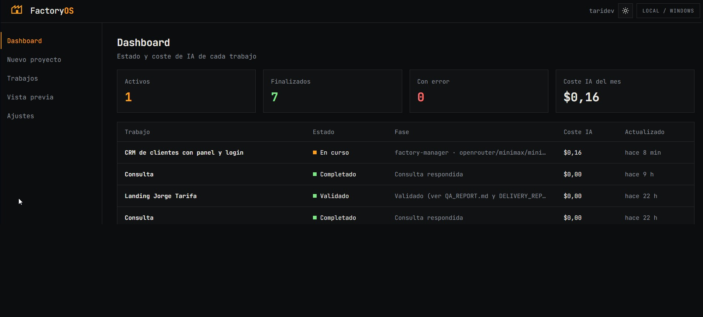
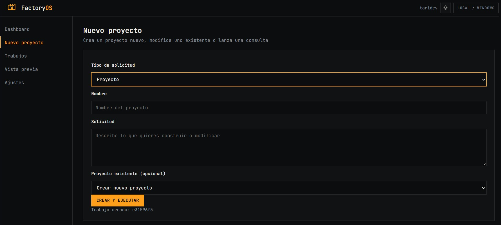
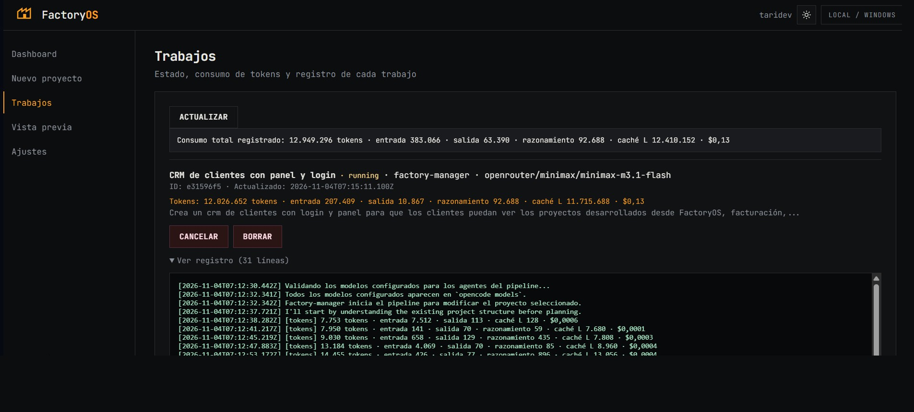
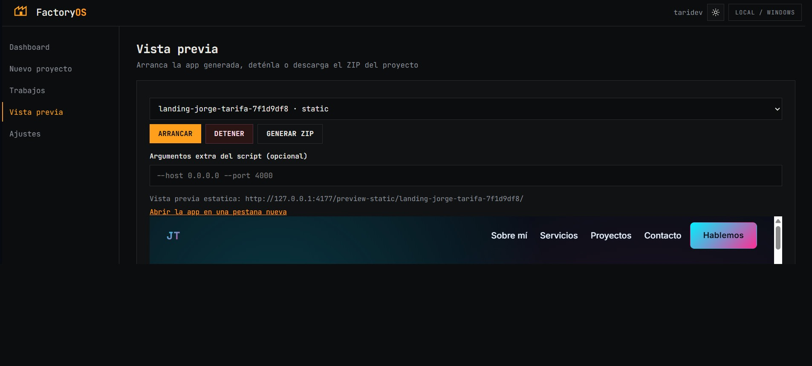
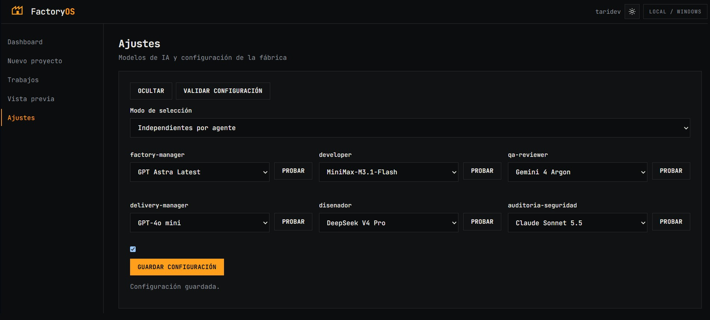
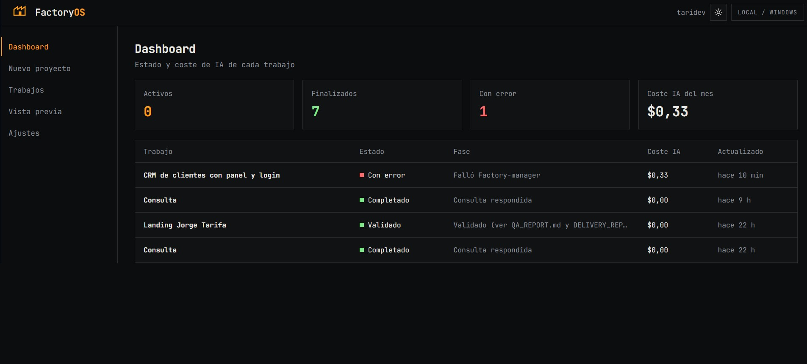

# FactoryOS
Fábrica autónoma de software con multiagentes IA para planificar, desarrollar, probar, corregir y entregar aplicaciones automáticamente.

<table>
  <tr>
    <td align="center" valign="top" width="50%">
       
      <b>Dashboard</b> · resumen de los trabajos
    </td>
    <td align="center" valign="top" width="50%">
       
      <b>Nuevo proyecto</b> · descripción y modelo
    </td>
  </tr>
  <tr>
    <td align="center" valign="top" width="50%">
       
      <b>Trabajos</b> · tokens y registro
    </td>
    <td align="center" valign="top" width="50%">
       
      <b>Vista previa</b> · app en marcha
    </td>
  </tr>
  <tr>
    <td align="center" valign="top" width="50%">
       
      <b>Ajustes</b> · modelo por agente
    </td>
    <td align="center" valign="top" width="50%">
       
      <b>Dashboard con error</b> · intervención necesaria
    </td>
  </tr>
</table>

Repositorio: <https://github.com/jtarifap/FactoryOS>

## Requisitos

- Windows 10/11.
- Node.js 20.19+ (o 22.12+ recomendado), npm, Git y OpenCode CLI instalado y autenticado.
- Un modelo OpenCode capaz de editar archivos y usar herramientas. Comprueba `opencode --version` y `opencode run --help`.
- Instala dependencias con `npm install`.

## Iniciar

1. Ejecuta `npm install` en esta carpeta.
2. Abre una terminal y ejecuta `npm run dev`.
3. Visita **http://127.0.0.1:5173**: verás la landing. Pulsa **Empezar** para abrir el panel de FactoryOS en **/app.html**.
4. Crea un proyecto de prueba pequeno. Los proyectos se crean en `projects/`.

## Interfaz web

- `web/index.html` + `web/landing.css`: landing estática en `/`.
- `web/app.html` + `web/main.ts`: panel de FactoryOS en `/app.html`.
- Menú lateral fijo de 220 px con las cinco secciones: **Dashboard**, **Nuevo proyecto**, **Trabajos**, **Vista previa** y **Ajustes**. La vista activa se marca en ámbar con barra izquierda y se refleja en el hash (`#/dashboard`), de modo que una recarga conserva la sección y se puede enlazar directamente.
- El **Dashboard** resume los trabajos con datos reales de `/api/jobs`: cuatro tarjetas (Activos, Finalizados, Con error y Coste IA del mes) y una tabla con Trabajo, Estado, Fase, Coste IA y Actualizado. El progreso se muestra con la fase real del trabajo porque OpenCode no expone un porcentaje.
- La cabecera muestra el logo a la izquierda y a la derecha `by taridev` (enlace a <https://taridev.com>, abre en pestaña nueva), el botón de tema y el chip `Local / Windows`.
- Los botones **Empezar** y **Crear mi primer proyecto** de la landing abren el panel; el logo del panel vuelve a la landing.
- Tema claro/oscuro: botón sol/luna junto a **LOCAL / WINDOWS** en el panel y después de **GitHub** en la landing, con persistencia en `localStorage` y oscuro por defecto.
- `vite.config.ts` declara ambas páginas como entradas: `npm run build` genera `dist/index.html` y `dist/app.html`. En desarrollo reenvía a la API tanto `/api` como `/preview-static`.

## Funcionamiento

- API Node.js/TypeScript en 127.0.0.1:4177.
- Interfaz Vite/TypeScript en 127.0.0.1:5173: `/` sirve la landing estática (`web/index.html` + `web/landing.css`) y `/app.html` el panel de FactoryOS (`web/main.ts`).
- Cola persistida en `data/jobs.json`, un trabajo a la vez.
- Worker con exclusión durante todo el ciclo y cancelación por árbol de procesos en todas las fases; un trabajo cancelado no se convierte en `failed` al cerrar. La cola conserva su orden.
- Factory-manager es el agente principal y predeterminado en OpenCode; es el único punto de entrada de la factoría y decide complejidad, stack y pipeline. Developer, QA, Diseñador, Auditoría de Seguridad y Delivery Manager son subagentes.
- En FactoryOS, el tipo de solicitud se selecciona explícitamente: **Proyecto** (predeterminado) o **Consulta**. Si se selecciona un directorio existente, se enruta como modificación al proyecto seleccionado.
- En Consulta, **Consultar** / **Escribe aquí tu consulta** es la entrada y **Respuestas** / **Respuestas a tus consultas** es la salida de solo lectura. Factory-manager responde directamente, sin crear directorios ni lanzar el pipeline.
- Al volver a Proyecto, se restauran Nombre, Solicitud y el selector Proyecto existente; los campos se limpian para evitar enviar la consulta anterior como solicitud de proyecto.
- Corrección automática: tras el pipeline se ejecuta una verificación técnica real (npm install/build/test). Si falla, Factory-manager coordina la corrección con el subagente adecuado, hasta 3 intentos. Si no se logra -> estado `Requiere intervención`.
- QA técnico: los proyectos de paquete deben tener al menos un script `build` o `test`; se ejecutan todos los configurados. Proyectos estáticos requieren `index.html` y se etiquetan como verificación superficial. El resultado automático se añade a `QA_REPORT.md` sin volcar salida cruda.
- Delivery Manager genera `ENTREGA.md` y `DELIVERY_REPORT.md` (con funcionalidades, dependencias, variables de entorno, instrucciones y problemas conocidos).
- Un proyecto solo queda `validated` si el pipeline termina correctamente y genera/actualiza un `DELIVERY_REPORT.md` reciente con las cinco secciones requeridas; las consultas terminan como `done`, sin artefactos de proyecto.
- Cada agente tiene su selector de modelo y botón **Probar**. Los modos **Independientes por agente** y **Modelo común** se guardan en `data/settings.json` y en el `model` del frontmatter OpenCode de cada agente.
- La configuración anterior había quedado en un solo modelo común; al recuperar el modo independiente, los seis agentes parten de ese modelo y se pueden personalizar por separado.
- La prueba del modelo usa el agente integrado `build` con una instrucción de responder solo OK, sin herramientas: no ejecuta los planes de los agentes de fábrica. El resultado se registra en el historial y estado del modelo.
- `autoApprove` (casilla): si esta marcada, los agentes ejecutan herramientas sin pedir permiso; desmarcada, OpenCode las rechaza y se informa en el log.
- Vista previa desde FactoryOS: **Arrancar** levanta la app del proyecto seleccionado. El script se elige del `package.json` por orden de preferencia (`dev`, `start`, `preview`, `serve`, `watch`) y, si faltan las dependencias, se ejecuta `npm install` antes.
- El puerto real de la app se deduce de su salida, porque no todas respetan `PORT` (`vite` solo acepta `--port`), y la URL definitiva se comprueba antes de mostrarla. El campo **Argumentos extra** añade flags al script (`--host 0.0.0.0 --port 4000`).
- Si la app no arranca, la vista previa muestra el error y los logs del proceso en lugar de un frame vacío, y el enlace **Abrir la app en una pestaña nueva** permite verla fuera del panel. Los proyectos estáticos (sin `package.json` pero con `index.html`) se sirven desde la API con una URL absoluta, de modo que el iframe muestra siempre la app y no la landing de FactoryOS.
- El refresco automático conserva el proyecto seleccionado en **Vista previa** y en el selector de modificación, mientras el proyecto siga existiendo.
- Los modelos se obtienen de `opencode models --verbose` y se prueban con `opencode run ... "Responde OK"` (timeout ~90s, con deteccion de cuota, credenciales, rate limit, timeout y retries abortadas cuando aparece un error real).
- Logs limitados y cancelación desde el panel. Las fases de proyecto tienen un timeout de 20 min; las consultas directas a Factory-manager, de 2 min.
- Cada trabajo muestra su consumo de tokens (entrada, salida, razonamiento y caché) y el coste estimado. El total incluye al Factory-manager y a los subagentes que hayan intervenido, y el panel muestra además el consumo global registrado.
- Para medir tokens sin mezclar trabajos, cada job usa una base SQLite aislada de OpenCode en `data/opencode/<job-id>.db`; si no se puede leer, se usa el respaldo de eventos `step_finish`. Al terminar un proyecto se escribe `factory/consumo-tokens.md` con el desglose.
- Se persiste `data/settings.json`, `data/jobs.json`, `data/model-tests.json` (historico de pruebas) y las bases de tokens en `data/opencode/`. Los JSON se escriben de forma atomica (temporal unico, `fsync` y reemplazo) para no perder el ultimo estado valido si falla el disco o el reemplazo. Al reiniciar, jobs en ejecucion -> `failed` + lastError.
- Proyectos generados en `projects/<slug>-<id>/` con README, código, tests, dist, QA_REPORT, ENTREGA y DELIVERY_REPORT.
- Cada trabajo persiste su accion (`new`, `modify` o `question`) y el worker la usa sin volver a inferirla del directorio. Los trabajos antiguos sin accion se tratan como consulta si su tipo era `question`, como modificacion si conservan un checkpoint y, en caso contrario, como creacion.
- Modificacion de proyectos existentes: el trabajo se aplica siempre sobre el proyecto original (no se crea una copia navegable). Antes de encolarlo se guarda un checkpoint verificado en `data/checkpoints/<slug>-<id>`, fuera de `projects/`. Si el checkpoint falla o el destino ya existe, el proyecto no se toca y el trabajo no se crea ni se encola. Los checkpoints antiguos `projects/<slug>-<id>-checkpoint` se ocultan de `/api/projects` pero no se borran.
- Historial de modificaciones: al elegir un proyecto en **Proyecto existente** (o en **Vista previa**) solo se listan debajo sus modificaciones, con icono `↳`, fecha y estado. Al pulsar una se muestra el detalle real del trabajo: peticion, fecha, estado y fase. No hay snapshots ni diffs, y un proyecto sin modificaciones no muestra nada. El selector nativo sigue siendo el unico punto de seleccion: los proyectos no se duplican en una lista aparte.
- Vista previa: arranca/detiene apps y sirve estáticos con MIME; niega archivos sensibles, traversal codificado, symlinks fuera del proyecto y contenido con credenciales conocidas. Los argumentos extra se validan antes de `spawn` (sin metacaracteres de shell). El HTML de preview solo puede enmarcarse desde el panel local. Al detener, mata el árbol de procesos completo (`taskkill /T /F`) esperando a que termine, para que la app no quede huérfana escuchando en su puerto.
- ZIP: excluye `.git`, `node_modules`, `.cache` y logs. Antes de crear el archivo inspecciona nombres y fingerprints de alta confianza; si encuentra credenciales/llaves o no puede completar el escaneo, bloquea la descarga sin devolver valores secretos. Empaqueta un snapshot de los bytes inspeccionados. Límites: 20 000 entradas, 1 MiB por archivo y 50 MiB inspeccionados. La descarga usa el nombre del proyecto, nunca una ruta absoluta.
- El escaneo conservador puede bloquear proyectos con archivos legítimos grandes; no garantiza detectar todo formato de secreto. No empaquetes proyectos con credenciales.

## Endpoints principales

- /api/health - estado
- /api/settings - config persistida (GET/PUT) incluye autoApprove
- /api/models - lista de modelos con metadata
- /api/models/providers - proveedores conectados en OpenCode y los que aun no ve FactoryOS
- /api/models/test - prueba individual de modelo
- /api/jobs - lista/crea/modifica trabajos (con delete/retry/cancel)
- /api/projects - listado de proyectos
- /api/projects/zip?directory=<slug> - descarga ZIP
- /api/preview/start|stop|status - gestion de apps generadas
- /preview-static/:slug/* - archivos estaticos protegidos

## Proveedores y credenciales de OpenCode

- El panel lista los modelos que ve el CLI de OpenCode (`opencode models --verbose`), agrupados por proveedor. Los agregadores como OpenRouter exponen ids con varios segmentos (`openrouter/openai/gpt-4.1`, `openrouter/~anthropic/claude-opus-latest`, `openrouter/thinkingmachines/inkling:free`): el panel los reconoce, los deja seleccionar y los escribe tal cual en el `model:` de cada agente.
- Las credenciales las guarda OpenCode, no FactoryOS. La app Desktop las escribe en su propia base SQLite y el CLI en `~/.local/share/opencode/auth.json`; FactoryOS no lee ni copia ningun valor de clave.
- Para que un proveedor añadido en la app Desktop aparezca en el panel, conectalo tambien en el CLI: `opencode auth login --provider <id>`.
- Comprobacion: `opencode auth list` debe listar el proveedor y `opencode models` debe mostrar sus modelos.

## Modo demo y publicacion estatica

- El panel decide su modo al arrancar: consulta `/api/health` y, si la API local no responde, entra en **modo demo** con datos de ejemplo. Con la API levantada, funciona igual que siempre.
- En modo demo el panel muestra una banda avisando de que los datos son de ejemplo, cambia el chip de la cabecera a `Demo · datos de ejemplo` y deshabilita las acciones que escriben en la API (crear, cancelar, reintentar, borrar, ZIP, vista previa, validar y guardar configuración), con un tooltip que indica que están disponibles en la versión local.
- El mismo build sirve para local y para producción: no hay variables de entorno que activar ni dos versiones distintas que mantener.
- Se puede forzar el modo desde la URL: `?demo=1` lo activa y `?demo=0` lo desactiva, sin tocar código.
- `render.yaml` publica el proyecto como **Static Site** (CDN global, plan gratuito). La landing es estática y el panel funciona en demo porque no hay servidor.

### Configuracion en Render

| Campo | Valor |
| --- | --- |
| Tipo | Static Site |
| Build Command | `npm ci && npm run build` |
| Publish Directory | `dist` |
| Environment | `SKIP_INSTALL_DEPS=true`, `NODE_VERSION=22.12.0` |

No hacen falta rewrites: la landing se sirve en `/` y el panel en `/app.html`, y el panel enruta por hash (`#/dashboard`).

El pipeline de agentes (OpenCode) no se ejecuta en Render: la version publicada es una demo de interfaz. Para la version funcional, FactoryOS se instala en local.

## Seguridad y persistencia

- La API escucha solo en `127.0.0.1:4177` y el panel en `127.0.0.1:5173` con `strictPort`. No se abre a interfaces externas.
- `server/request-security.ts` valida antes de enrutar: `Host` exacto de loopback, `Origin` exacto del panel/API en peticiones mutables, rechazo de `Sec-Fetch-Site: cross-site` en `/api`, rechazo de `OPTIONS` y `Content-Type: application/json` en los endpoints que parsean JSON. No se emite CORS comodín. Las peticiones locales sin `Origin` (curl/PowerShell) siguen funcionando.
- `server/project-paths.ts` es el unico resolutor de proyectos: rechaza rutas absolutas, traversal, nombres reservados/invalidos de Windows, symlinks y junctions; comprueba la contencion canonica tras `realpath`. Jobs, preview, estáticos, listado y ZIP lo comparten.
- La lectura de archivos estáticos usa un descriptor y `fstat`; en plataformas que lo soportan se añade `O_NOFOLLOW`, y siempre se valida la ruta canonica antes de abrir.
- Jobs cancelados/no terminados -> `failed` al reiniciar, con lastError human-readable.
- Las bases de tokens de `data/opencode/` contienen sesiones de OpenCode: permanecen en local, no se publican y se eliminan al borrar el trabajo.
- No se ejecutan comandos fuera de `projects/`. Los argumentos de preview se validan antes de `spawn`.
- Los logs de jobs y preview, `lastError`, `answer` y los errores del ZIP pasan por `redactSecrets`; las respuestas de bloqueo solo muestran rutas, nunca valores.
- ZIP aplica detección por nombres y fingerprints de alta confianza; no es un escáner universal ni reemplaza la revisión del proyecto. El escaneo conservador puede bloquear proyectos con archivos legítimos grandes.
- No hay autenticación local: cualquier proceso de la misma máquina puede llamar a la API. La defensa es loopback + validación de Host/Origin, no la identidad del usuario.
- En Windows no existe `O_NOFOLLOW`: queda una ventana TOCTOU teórica si otro proceso local reemplaza un archivo durante la lectura.
- No se hace push ni despliegue sin autorizacion.
- Procesos hijos se detienen en cancelacion mediante `taskkill /T /F`.
- Este README documenta controles concretos; no certifica que toda la aplicación sea segura.

## Estructura y QA

- `web/`: landing (`index.html`, `landing.css`) y panel (`app.html`, `main.ts`, `style.css`).
- `server/`: API Node.js/TypeScript, ejecución de agentes y lectura del consumo de tokens.
- `shared/`: cálculo y formato de tokens compartido entre servidor y panel.
- `server/model-list.ts`: parser del catalogo de modelos de OpenCode (ids multi-segmento de proveedores agregadores).
- `server/opencode-providers.ts`: proveedores conectados en OpenCode (solo identificadores, nunca valores de credencial).
- `server/preview-plan.ts`: elección de script, argumentos y detección del puerto de la app en la vista previa.
- `web/navigation.ts`: items del menú lateral y sincronización de la vista activa con el hash.
- `web/dashboard.ts`: estadísticas y filas de la tabla del dashboard (lógica pura, sin DOM).
- `web/demo.ts`: detección del modo demo, datos de ejemplo y backend que sustituye a la API.
- `render.yaml`: configuración de publicación como sitio estático en Render.
- `tests/`: pruebas de API, rutas/symlinks, Host/Origin/CSRF, secretos y redaccion, ZIP, preview y landing.
- `public/images/readme/`: capturas del panel que usa la rejilla de este README, todas a 1905×861 para que la tabla quede pareja; el clic abre la imagen a tamaño completo.
- `projects/`: proyectos generados por la fábrica.
- Cada proyecto incluye `README.md`, `package.json`, codigo, tests, `dist/`, `QA_REPORT.md`.
- `QA_REPORT.md` se genera con evidencias reales (build/test).
- `DELIVERY_REPORT.md` genera resumen de entrega.

## Advertencias

- Primera ejecucion no validada con tu proveedor/modelo OpenCode: hay que probar el CLI en tu Windows.
- En Windows el lanzamiento de archivos .cmd puede depender de la version de Node.
- Los permisos de OpenCode pueden requerir aprobacion interactiva si autoApprove esta desactivado.
- El estado `done`/`validated`/`needs_intervention` significa que se ha ejecutado el flujo sin errores de proceso; aun asi consulta QA_REPORT.md.
- No es seguro exponer esta API en Internet: sin autenticacion.
- No uses proyectos con credenciales en esta alpha.
- Al reiniciar, los trabajos en ejecucion pasan a `failed` y se puede usar `Reintentar`.
- README.md dentro de cada proyecto es la guia de uso.

## Prueba rapida

- `npm run build` verifica TypeScript y construye la landing y el panel en `dist/`.
- `npm test` ejecuta pruebas unitarias/regresión y handlers ZIP/preview con fixtures sintéticos; no llama a proveedores reales. En Windows, los tests de ZIP usan `tar.exe`.
- Para usar el agente principal en OpenCode, selecciona `factory-manager` en la lista de agentes o ejecuta `opencode run --agent factory-manager "tu petición"` desde el proyecto.
- `tests/landing.test.mjs` valida la landing: secciones, estilos y botones que abren `/app.html`.
- `tests/demo-mode.test.mjs` y `tests/demo-wiring.test.mjs` validan la detección del modo demo, los datos de ejemplo y el cableado del panel.
- `tests/navigation.test.mjs` y `tests/dashboard.test.mjs` validan el menú lateral y los datos del dashboard; `tests/preview-plan.test.mjs` y `tests/preview-kill.test.mjs` validan el arranque y la parada de la app en la vista previa.
- `curl http://127.0.0.1:4177/api/health` comprueba la API mientras esta en ejecucion.
- Crea un proyecto "hola mundo" desde FactoryOS y observa logs/QA report.
